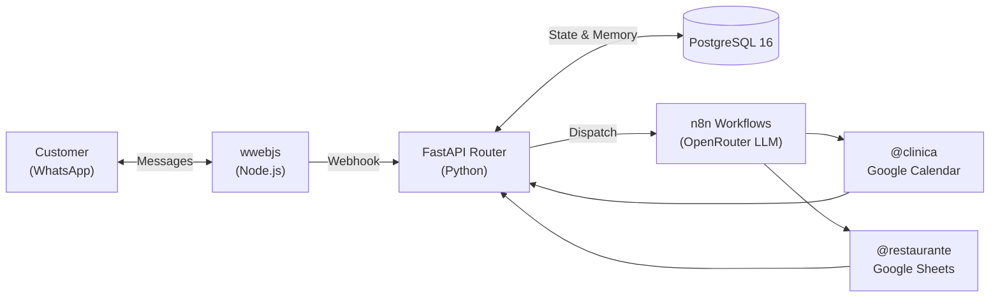

# n8n Customer Service Gateway

> Multi-tenant WhatsApp gateway for automated customer service, appointment scheduling, and order management built with **n8n**, **FastAPI (Python)**, **whatsapp-web.js (Node.js)**, and **PostgreSQL**.

## Architecture



| Service | Stack | Role |
| :--- | :--- | :--- |
| **WhatsApp Client** | Node.js + `whatsapp-web.js` | Manages WhatsApp Web session and message ingestion/delivery. |
| **Gateway Router** | Python + `FastAPI` + `asyncpg` | Command routing (`@clinica`, `@restaurante`, `@fim`) and session management. |
| **Workflow Engine** | `n8n` + OpenRouter (`nvidia/nemotron-3.5-lightning:free`) | AI agents, tool calling, and scheduled cron jobs. |
| **Database** | `PostgreSQL 16` | Unified storage for n8n state, `chat_history`, and `active_sessions`. |

## Workflows (`n8n-workflows.json`)

Users interact through a single WhatsApp number and switch contexts using prefixes:

* **`@clinica` (Clinic Scheduling):** Checks availability, books, reschedules, and cancels appointments in **Google Calendar**, plus a daily 09:00 reminder cron.
* **`@restaurante` (Orders & Reservations):** Checks menu stock, registers orders, and books tables in **Google Sheets**, plus a weekly Monday 08:00 summary cron.
* **`@fim` (Reset):** Clears the active session and purges conversation history in PostgreSQL.

## Screenshots

<!-- Add screenshots of the n8n canvas and WhatsApp conversation here -->
* *n8n Workflow Canvas:* `docs/n8n-canvas.png`
* *WhatsApp Interaction:* `docs/whatsapp-demo.png`

## Quick Start

```bash
cp .env.example .env
docker compose up --build
```

* **WhatsApp Gateway:** `http://localhost:3000` (scan QR code in logs on first run)
* **FastAPI Docs:** `http://localhost:8000/docs`
* **n8n UI:** `http://localhost:5678` (import `n8n-workflows.json`)
